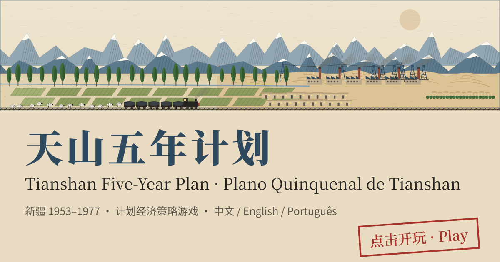

# 天山五年计划 · Tianshan Five-Year Plan

**▶ 在线游玩 · Play online · Jogar online：<https://jabarrick.github.io/tianshan-plan/>**

---

## 中文

以新疆为背景的计划经济策略游戏。你是 1953—1977 年自治区计划委员会主任：这里没有价格，只有调拨单。每年编制钢材、水泥、劳动力、煤电四张物资平衡表，在北疆、南疆、东疆之间调粮，修水利、垦荒、建油田、通铁路，完成中央的统购任务，撑过大跃进、苏联专家撤离和文化大革命。

- 两个剧本：全任期 1953—1977，或从三年困难之后的 1963 年接手
- 三档难度、15 个历史事件、21 个随机事件、5 项跨年重点工程、地区专员人事
- 终评与历史数据对照，并按你的经营生成后记
- 中文 / English / Português 三语，随时切换
- 单个 HTML 文件，无需安装；进度自动保存在浏览器

> 游戏中的数据、事件效果与地图均为简化的游戏设定，不代表精确的历史数据；地图为示意图，界线与比例均为概略。

## English

A planned-economy strategy game set in Xinjiang. You direct the regional Planning Commission from 1953 to 1977. There are no prices, only allocation orders: each year you balance steel, cement, labour and power, move grain between north, south and east, build irrigation, farms, oilfields and railways, meet the Centre's state quotas, and try to survive the Great Leap Forward, the Soviet withdrawal and the Cultural Revolution.

Figures, event effects and the map are simplified game mechanics, not precise historical data; the map is schematic.

## Português

Jogo de estratégia de economia planificada passado em Xinjiang. Diriges a Comissão de Planeamento entre 1953 e 1977. Não há preços, só ordens de afetação: todos os anos equilibras aço, cimento, mão de obra e energia, transferes cereal entre Norte, Sul e Leste, constróis rega, quintas, campos petrolíferos e ferrovias, cumpres as quotas do Centro e tentas sobreviver ao Grande Salto em Frente, à retirada soviética e à Revolução Cultural.

Os números, os efeitos dos eventos e o mapa são mecânicas simplificadas do jogo, não dados históricos exatos; o mapa é esquemático.

---

## 分享到 Facebook · Sharing on Facebook

把游戏网址 <https://jabarrick.github.io/tianshan-plan/> 粘贴到 Facebook 帖子或 Messenger，会自动显示带预览图的卡片，点击即可在手机或电脑上直接开玩，无需安装。

Paste the game URL into a Facebook post or Messenger chat: it unfurls into a preview card, and one tap opens the game.
